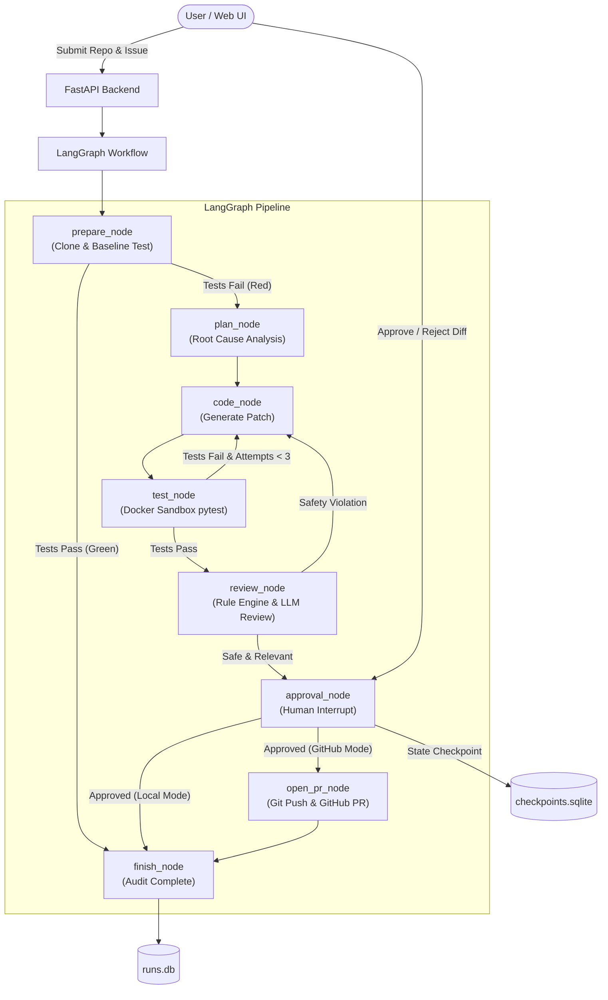

# Issue-to-PR Agent

> **Autonomous Bug-Fix Agent with Human-in-the-Loop Approval**  
> Powered by LangGraph, Docker Sandboxing, Groq LLM inference, FastAPI, and React.

---

## 📌 Problem Statement & Overview

Software engineers spend considerable time triaging bug reports, tracing error logs, writing regression fixes, running local test suites, and creating pull requests.

The **Issue-to-PR Agent** automates this entire lifecycle autonomously and safely:
1. **Analyzes** a bug report (issue title and description) alongside the target codebase.
2. **Reproduces** the bug via an initial baseline test run in an isolated Docker sandbox.
3. **Plans & Patches** the code using Groq's high-speed LLM inference.
4. **Validates** the fix in an isolated sandbox with zero network access and strict resource boundaries.
5. **Screens** the patch with deterministic security rules (AST token blocking, scope limits, test tampering checks).
6. **Pauses for Human Approval** via LangGraph state checkpoints and an interactive web interface.
7. **Opens a GitHub Pull Request** automatically once approved by a human engineer.

---

## 🏗️ Architecture



---

## 🛡️ Safety & Security Design

To prevent arbitrary code execution, security regressions, or repository corruption, the agent implements multi-layered guardrails:

* **Docker Network Isolation**: Containers run with `--network none`. Patched code cannot call external APIs, exfiltrate secrets, or access the local network.
* **Sandbox Resource Bounds**: Execution is constrained to **512MB RAM**, **1 CPU core**, **128 PIDs**, a non-root `sandboxuser`, and a hard **60-second execution timeout**.
* **Protected Test Suite**: The patch validation engine strictly rejects any modification to test files (e.g., `test_*.py`, `conftest.py`). The agent cannot cheat by deleting or altering tests.
* **Token Allowlist & Blocking**: Deterministic AST/token scanning blocks dangerous primitives:
  `os.system`, `subprocess`, `eval`, `exec`, `socket`, `requests`, `urllib`.
* **Scope Enforced**: Diffs are limited to a maximum of **2 files** and **40 lines** of changes to prevent massive code drifts.
* **Branch Isolation**: In GitHub mode, direct pushes to `main` or protected branches are programmatically blocked. Changes are only pushed to dedicated `agent/issue-*` branches.
* **Human-in-the-Loop Sign-off**: No code is ever pushed or merged into GitHub without explicit human approval of the unified diff.

---

## 🚀 Quickstart & Setup

### 1. Prerequisites
* **Python 3.11+**
* **Docker Desktop** (running)
* **Node.js 18+** & **npm**
* **Git**

### 2. Environment Configuration
Clone or navigate to the project directory and create your `.env` file:

```bash
cp .env.example .env
```

Configure your `.env` variables:
```env
# Required: Groq API Key (https://console.groq.com)
GROQ_API_KEY=gsk_your_groq_api_key_here
GROQ_MODEL=llama-3.3-70b-versatile

# Optional: GitHub Personal Access Token (Required only for GitHub Mode to push branches & open PRs)
GITHUB_TOKEN=ghp_your_github_token_here
```

### 3. Build the Sandbox Docker Image
Build the isolated testing container:

```bash
docker build -t issue-sandbox -f sandbox/Dockerfile sandbox
```

### 4. Install Backend Dependencies & Start Server
Set up your Python virtual environment and run the FastAPI server:

```powershell
# Create & activate venv
python -m venv myenv
myenv\Scripts\activate   # On Linux/macOS: source myenv/bin/activate

# Install requirements
pip install -r requirements.txt

# Start backend
python -m uvicorn backend.main:app --reload --port 8000
```
The backend API is now running at `http://localhost:8000`.

### 5. Install Frontend Dependencies & Start UI
In a separate terminal:

```bash
cd frontend
npm install
npm run dev
```
The web dashboard is now accessible at `http://localhost:5173`.

---

## 🖥️ Using the Web Dashboard

1. Open `http://localhost:5173` in your browser.
2. Fill in the **Start New Run** form:
   * **Repository (Path or URL)**: A local folder path (e.g., `benchmark/bugs/bug1_off_by_one`) or a remote GitHub URL (e.g., `https://github.com/owner/repo`).
   * **Issue Title**: Short description of the problem.
   * **Issue Body**: Details or reproduction steps.
   * **Mode**:
     * `Local (Benchmark / Sandbox only)`: Runs the full fix and test cycle in Docker; allows reviewing the diff locally without pushing to GitHub.
     * `GitHub (Branch & Pull Request)`: Pushes the verified fix to an `agent/issue-*` branch and opens a live Pull Request upon approval.
3. Click **Submit Run**.
4. Review the generated diff and test results when the status updates to **Awaiting Approval**, then click **Approve** or **Reject**.

---

## 📊 Benchmark Evaluation

The project includes an automated benchmark suite consisting of **15 seeded bug repositories** ([`benchmark/bugs/`](benchmark/bugs/)) covering common real-world bugs (off-by-one errors, None checks, mutable defaults, boundary conditions, zero division, case sensitivity, etc.).

Each bug repository includes:
* **Visible Tests**: Public tests reproducing the bug that the agent uses to verify its patch.
* **Hidden Tests**: Unseen evaluation tests used to verify that the fix generalizes correctly without overfitting or breaking edge cases.

### Running the Benchmark Suite
To run the full autonomous evaluation across all benchmark targets:

```bash
python benchmark/run_benchmark.py
```

Evaluation metrics computed:
* **Visible Test Pass Rate (%)**
* **Hidden Test Pass Rate (%)** (generalization measure)
* **Average Attempts per Bug** (retry loop efficiency)
* **Average Duration per Fix (seconds)**
* **Total & Average Tokens Used**
* **Estimated LLM Inference Cost (USD)**
* **Safety Violations Detected (0 expected)**

A comprehensive evaluation log is generated at [`EVALUATION_REPORT.md`](EVALUATION_REPORT.md).

---

## 📁 Repository Structure

```
codechanger/
├── backend/
│   ├── main.py          # FastAPI REST API endpoints
│   ├── graph.py         # LangGraph workflow, nodes, and checkpoint resume logic
│   ├── tools.py         # Patch rules, AST token checks, Groq LLM caller, Git helpers
│   ├── sandbox.py       # Docker subprocess execution, resource limiting, safe cleanup
│   └── db.py            # SQLite run audit database (runs.db)
├── frontend/
│   ├── src/
│   │   ├── App.jsx      # React SPA dashboard with live unified diff viewer
│   │   └── main.jsx     # Vite React entrypoint
│   ├── index.html       # Single-page HTML shell
│   └── package.json     # Frontend dependencies
├── sandbox/
│   └── Dockerfile       # Hardened Python 3.11 container with pytest & ML stubs
├── benchmark/
│   ├── bugs/            # 15 isolated benchmark repositories (bug1 through bug15)
│   └── run_benchmark.py # Automated test harness measuring pass rate & generalization
├── .env.example         # Template for environment configuration
├── requirements.txt     # Python backend dependencies
├── checkpoints.sqlite   # LangGraph checkpoint persistence database
├── runs.db              # Permanent run audit database
└── README.md            # Project documentation
```

---

## ⚠️ Known Limitations

* **Python & Pytest Only**: Current sandbox environment is tailored for Python projects using `pytest`.
* **Small-to-Medium Scope**: Designed for targeted bug fixes ($\le 2$ files, $\le 40$ lines changed). Large multi-file architectural refactors are intentionally out of scope.
* **Test-Driven Requirement**: The repository must have a reproducing test that fails prior to patching. If all tests pass on an unpatched repo, the agent halts safely with status `no_failing_test`.
